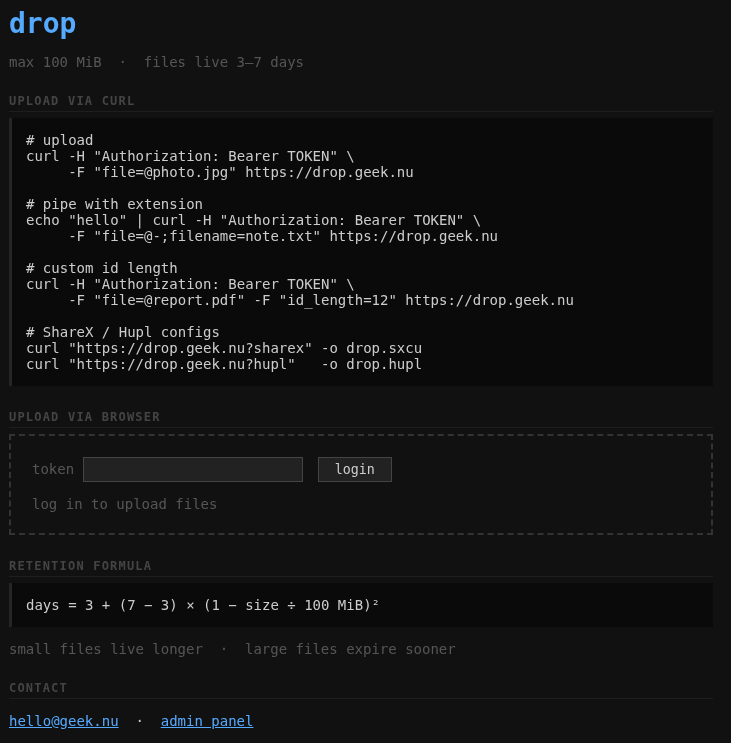
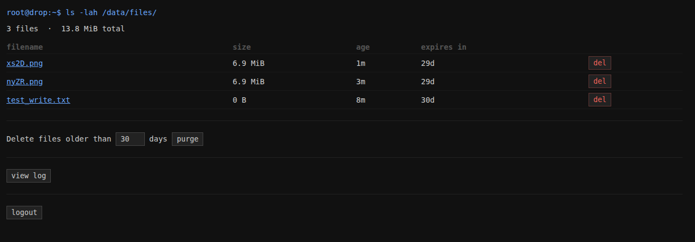

# drop

[](https://klppl.github.io/lagom-license/)

A self-hosted file drop service. Upload files via `curl` or browser, share a short link. Dark monospace aesthetic, curl-friendly API, upload auth, an admin panel.



- Zero runtime dependencies — single Go binary
- ~12 MB Docker image, ~15 MB RAM at idle
- Token-protected uploads (master token or per-device app tokens), password-protected admin panel
- EXIF stripping for JPEG, PNG, GIF
- Files expire automatically using a size-based decay formula, or sooner on request
- Delete tokens, burn-after-reading, multi-file browser uploads, text pastes

---

## Quick start

```bash
git clone <repo>
cd drop
cp .env.example .env
$EDITOR .env          # set UPLOAD_TOKEN and ADMIN_PASSWORD
docker compose up -d --build
```

The service is now reachable on port 80.

---

## Environment variables

Set these in your `.env` file (copied from `.env.example`).

### Upload auth

| Variable | Default | Description |
|---|---|---|
| `UPLOAD_TOKEN` | *(empty)* | Master token callers must supply to upload. Leave empty for open uploads. App tokens generated in the admin panel work alongside it. |
| `REQUIRE_AUTH` | `true` if token is set, `false` otherwise | Explicitly enable or disable auth. Set to `false` to allow open uploads even when a token is configured. |
| `UPLOAD_RATE_LIMIT` | `60` | Anonymous uploads per IP per hour (only applies when auth is off). `0` = unlimited. Authenticated uploads are not rate-limited. |

### File limits

| Variable | Default | Description |
|---|---|---|
| `MAX_FILESIZE` | `256` | Maximum upload size in **MiB**. Also set `NGINX_MAX_BODY_MIB` to `MAX_FILESIZE + 2`. |
| `NGINX_MAX_BODY_MIB` | `258` | nginx `client_max_body_size`; must stay in sync with `MAX_FILESIZE`. |

### Retention

| Variable | Default | Description |
|---|---|---|
| `MAX_FILE_AGE` | `30` | Maximum days a file is kept (applies to the smallest files). |
| `MIN_FILE_AGE` | `3` | Minimum days a file is kept (applies to max-size files). |

### Admin and runtime

| Variable | Default | Description |
|---|---|---|
| `ADMIN_PASSWORD` | `changeme` | Password for the `/admin` panel. **Change this before exposing publicly.** |
| `ADMIN_EMAIL` | `admin@example.com` | Contact email shown on the index page. |
| `TZ` | `UTC` | Timezone for log timestamps, e.g. `Europe/Amsterdam`. |
| `PORT` | `8080` | Port the Go binary listens on. |
| `DATA_DIR` | `/data` | Where files, metadata, tokens and the log are stored. |

**`.env` example:**

```dotenv
UPLOAD_TOKEN=mysecrettoken
REQUIRE_AUTH=true
MAX_FILESIZE=512
NGINX_MAX_BODY_MIB=514
MAX_FILE_AGE=14
MIN_FILE_AGE=1
ADMIN_PASSWORD=anothersecretpassword
ADMIN_EMAIL=you@example.com
TZ=Europe/Amsterdam
```

---

## Mapping a folder for uploads

By default the compose file uses a named Docker volume (`drop_data`). This means files are managed by Docker and stored in `/var/lib/docker/volumes/`. If you want files on a specific path on the host — for easy backup, browsing, or mounting on a NAS — replace the named volume with a bind mount.

**Edit `docker-compose.yml`:**

```yaml
services:
  drop:
    volumes:
      # Replace the named volume with a path on your host:
      - /your/host/path:/data

# Remove or comment out the volumes section at the bottom:
# volumes:
#   drop_data:
```

The container writes these inside `/data`:

| Path inside container | Contents |
|---|---|
| `/data/files/` | Uploaded files |
| `/data/meta/` | Per-file metadata: hashed delete token, requested expiry, burn flag |
| `/data/burn/` | Burn-after-reading files while their single download is in progress |
| `/data/uploads.log` | Upload log (timestamp, IP, size, original name, stored name) |
| `/data/tokens.json` | App tokens (mode 0600) |
| `/data/extensions.json` | Allowed extensions, if changed in the admin panel |

**Full bind-mount example:**

```yaml
services:
  nginx:
    image: nginx:alpine
    restart: unless-stopped
    ports:
      - "80:80"
    environment:
      NGINX_MAX_BODY_MIB: ${NGINX_MAX_BODY_MIB:-258}
    volumes:
      - ./nginx/templates:/etc/nginx/templates:ro
    depends_on:
      - drop

  drop:
    build: .
    restart: unless-stopped
    environment:
      UPLOAD_TOKEN:   ${UPLOAD_TOKEN:-}
      REQUIRE_AUTH:   ${REQUIRE_AUTH:-}
      UPLOAD_RATE_LIMIT: ${UPLOAD_RATE_LIMIT:-60}
      MAX_FILESIZE:   ${MAX_FILESIZE:-256}
      MAX_FILE_AGE:   ${MAX_FILE_AGE:-30}
      MIN_FILE_AGE:   ${MIN_FILE_AGE:-3}
      ADMIN_PASSWORD: ${ADMIN_PASSWORD:-changeme}
      ADMIN_EMAIL:    ${ADMIN_EMAIL:-admin@example.com}
      TZ:             ${TZ:-UTC}
    volumes:
      - /srv/drop:/data   # <-- your host path here
```

> The container runs as a non-root user (`drop`). Make sure the host directory is owned or writable by UID/GID **65534** (the Alpine `nobody`/`drop` user), or relax permissions with `chmod 777 /srv/drop`.
>
> ```bash
> mkdir -p /srv/drop/files
> chown -R 65534:65534 /srv/drop
> ```

---

## Uploading files

### curl (plain text response)

```bash
# Open instance
curl -F "file=@photo.jpg" http://localhost

# With upload token (see "Getting your token" below)
curl -H "Authorization: Bearer $DROP_TOKEN" \
     -F "file=@photo.jpg" http://localhost

# Pipe content (set filename to get extension right)
echo "hello world" | curl -F "file=@-;filename=note.txt" http://localhost

# Custom ID length (4–24 chars, default 4)
curl -F "file=@report.pdf" -F "id_length=10" http://localhost

# Expire sooner than the retention formula (10m, 1h, 7d, 1h30m, ...)
curl -F "file=@report.pdf" -F "expires=1h" http://localhost

# Burn after reading: deleted after the first download
curl -F "file=@secret.pdf" -F "burn=1" http://localhost
```

The response body is a plain URL, e.g. `http://localhost/f/aBc1.jpg`. Two response headers carry extra information:

| Header | Meaning |
|---|---|
| `X-Delete-Token` | Secret that lets you delete this file (only shown once) |
| `X-Expires` | When the file will be removed (RFC 3339) |

Upload form fields: `file` (required), `id_length`, `expires`, `burn`, and `token` (alternative to the auth headers).

### Deleting your upload

Use `curl -i` to see the delete token, then:

```bash
curl -X DELETE -H "X-Delete-Token: <token>" http://localhost/f/aBc1.jpg
```

The browser page remembers delete tokens for you (see below).

### Burn after reading

With `burn=1` the first `GET` claims the file and deletes it once served. `HEAD` requests and views from a logged-in admin do not count. Range requests get the full file, since a partial response would burn the file without delivering it. Chat apps that unfurl links (Slack, Discord, etc.) will fetch the URL and use up the download, so share burn links where previews are off.

### Browser

Visit `http://localhost`. You can:

- pick or drag & drop several files (they upload one after another), or paste an image with Ctrl+V / Cmd+V
- choose an expiry and tick **delete after first download**
- open **paste text** to upload text as `paste.txt` (or a filename you choose)
- copy each link, or delete the file with its stored delete token

**Recent uploads** lists what this browser uploaded (kept in `localStorage`, up to 50 entries, expired ones dropped). **forget list** only clears the list; files stay online until they expire.

### Getting your token

When auth is enabled, log in on the index page with your upload token (or log in to `/admin`). The curl examples then show an `export DROP_TOKEN=…` line with your token (hidden until you click **show token**), a **copy export line** button, and download links for ShareX and Hupl configs with your token already filled in.

```bash
export DROP_TOKEN='your-token'   # once, or put it in ~/.bashrc
curl -H "Authorization: Bearer $DROP_TOKEN" -F "file=@photo.jpg" http://localhost

# optional helper: drop photo.jpg
drop() { curl -H "Authorization: Bearer $DROP_TOKEN" -F "file=@$1" http://localhost; }
```

Upload-token logins see the token they logged in with. Admins see `UPLOAD_TOKEN`, and the admin panel's **api tokens** section generates per-device tokens with their own config links. Revoking an app token also ends any browser session that logged in with it.

### ShareX / Hupl

When auth is enabled, use the **ShareX config** / **Hupl config** links on the index page after logging in, or the per-token links in the admin panel. The config already contains your token, so you can import it directly.

If auth is disabled (`REQUIRE_AUTH=false` / no `UPLOAD_TOKEN` set), the configs are public and contain no token:

```bash
curl "http://localhost?sharex" -o drop.sxcu
curl "http://localhost?hupl"   -o drop.hupl
```

---

## Admin panel



Visit `http://localhost/admin` and log in with `ADMIN_PASSWORD`.

Features:
- File list with size, age, time until expiry, and a `burn` tag for burn-after-reading files
- Delete individual files or a selection
- Bulk purge: delete all files older than N days
- Add / remove allowed file extensions
- App tokens: generate per-device upload tokens, see their usage, revoke them, and download ShareX / Hupl configs per token
- View the last 200 lines of the upload log
- Logout

Login attempts are rate-limited to 10 failures per IP per hour.

---

## File retention

Files are not kept forever. Retention is based on file size:

```
days = MIN_FILE_AGE + (MAX_FILE_AGE − MIN_FILE_AGE) × (1 − size ÷ MAX_FILESIZE MiB)²
```

With the defaults (`MIN_FILE_AGE=3`, `MAX_FILE_AGE=30`, `MAX_FILESIZE=256`):

| File size | Retained for |
|---|---|
| 1 KB | ~30 days |
| 25 MiB | ~24 days |
| 100 MiB | ~12 days |
| 256 MiB | 3 days |

An uploader can ask for a shorter life with `expires`, never a longer one.

Expired files are purged hourly by a background job in the server, and also on access. If disk usage goes over 90 %, the oldest files are evicted until it is below 80 %. You can also trigger a purge manually:

```bash
docker compose exec drop /app/drop purge
```

---

## Allowed file types

| Category | Extensions |
|---|---|
| Images | `jpg`, `jpeg`, `png`, `gif`, `webp`, `avif`, `heic` |
| Documents | `pdf` |
| Text | `txt`, `md`, `csv`, `log`, `json` |

These are the defaults; the admin panel can change the list. SVG, HTML, and XML are intentionally excluded (XSS risk).

JPEG, PNG, and GIF uploads are decoded and re-encoded to strip EXIF metadata before storage; files that do not decode are rejected. Images over 50 megapixels, and GIFs whose frames add up to more than 200 megapixels, are rejected to prevent decompression bombs. Only JPEG, PNG and GIF are shown inline; everything else (including text pastes) is served as a download.

---

## TLS / reverse proxy

The service listens on HTTP only. Put it behind a TLS-terminating reverse proxy (Caddy, Traefik, nginx with Let's Encrypt). The app reads `X-Forwarded-Proto` to construct correct `https://` URLs in responses.

If you already have a proxy in front of the nginx container and want to skip nginx entirely, you can expose the `drop` service directly:

```yaml
  drop:
    ports:
      - "8080:8080"
```

---

## Health check

`GET /healthz` returns `ok` when the store directory is reachable. The Docker image's `HEALTHCHECK` runs `/app/drop health`, which calls it every 30 seconds.

---

## Development

```bash
go vet ./...
go test -race ./...
DATA_DIR=./data go run .   # run locally without Docker
```

---

## Resource usage

| Metric | Value |
|---|---|
| Docker image size | ~12 MB |
| RAM at idle | ~15 MB |
| External Go dependencies | none |
| Processes in container | 1 (the binary) |
